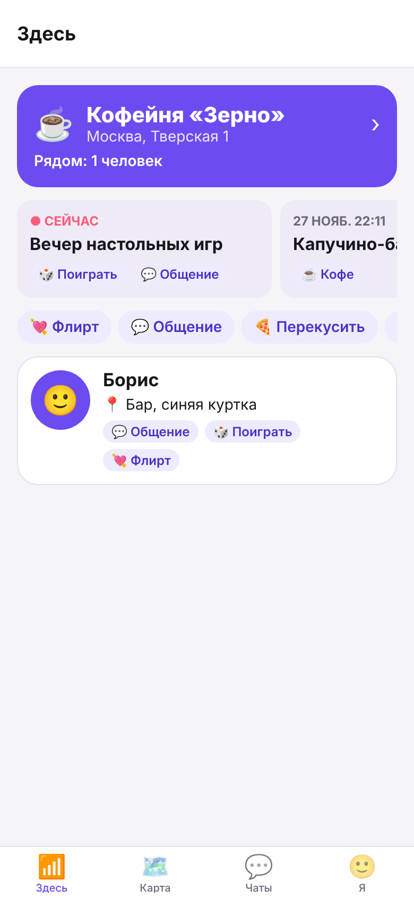
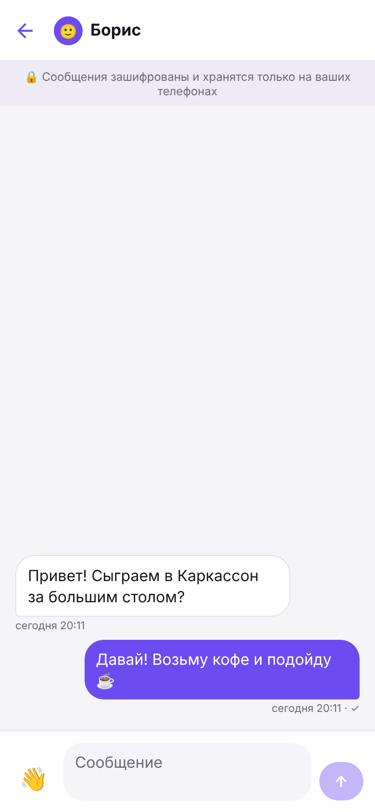
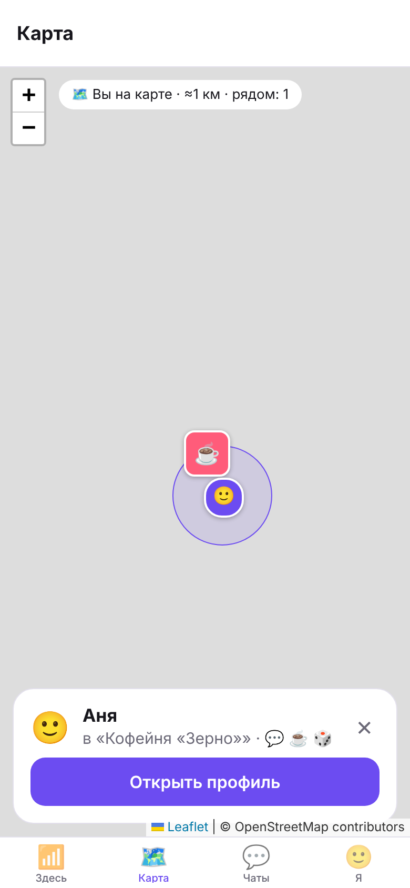
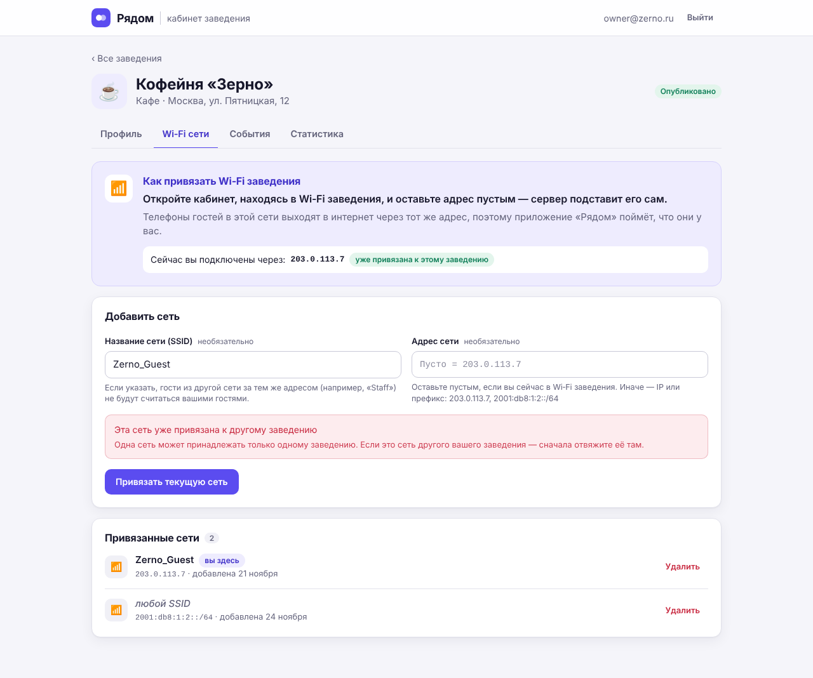

# Рядом

Приложение для знакомств и общения с людьми, которые **прямо сейчас в том же месте**: в ресторане, вагоне поезда,
спортзале, коворкинге. «То же место» = подключены к одной Wi‑Fi сети.

* **Минимальная функция.** Открыл приложение в кафе и видишь, кто ещё здесь и зачем: 💘 флирт, 💬 общение,
  🍕 перекусить, ☕ кофе, 🎲 поиграть, 🏋️ спорт, 🧳 попутчики и другие цели. Можно помахать 👋 или написать.
* **Данные пользователя — на устройстве.** Профиль, переписка, блокировки и ключи хранятся на телефоне.
  Сервер держит профиль в памяти, только пока приложение открыто. Сообщения он пересылает зашифрованными
  (сквозное шифрование) и не сохраняет.
* **Карта — по желанию.** Если человек сам разрешил, он виден на карте другим таким же людям. Позиция огрублена
  до района (~1 км) или квартала (~250 м). Заведения и их события на карте видны всем.
* **Кабинет заведения.** Кафе, клуб, спортзал или перевозчик регистрирует заведение и привязывает свой Wi‑Fi.
  После этого гости видят название места и его события, а заведение — обезличенную живую статистику.

<p align="center">
  
  
  
</p>
<p align="center">
  
</p>

## Как определяется «одна Wi‑Fi сеть»

Телефоны в одной Wi‑Fi сети выходят в интернет через один роутер, поэтому сервер видит у них общий адрес.

| Что видит сервер | Ключ сети |
|---|---|
| публичный IPv4 (NAT роутера) | сам адрес — `203.0.113.7` |
| IPv6 (у каждого устройства свой адрес) | общий префикс `/64` |
| частный IPv4 (сервер в той же локальной сети) | подсеть `/24` |

Дополнительно приложение передаёт **хэш** названия сети (SSID). Он разделяет разные сети за одним адресом,
например «Guest» и «Staff» в отеле. Само название и GPS на сервер не уходят.

Если телефон в мобильной сети, «зоны» нет. Там оператор (CGNAT) выводит в интернет через один адрес тысячи
незнакомых людей, поэтому приложение просит подключиться к Wi‑Fi.

Подробнее о правилах видимости, шифровании и модели угроз — в [docs/ARCHITECTURE.md](docs/ARCHITECTURE.md).

## Состав репозитория

```
shared/           протокол (zod-схемы), E2E-шифрование (tweetnacl), нормализация сетей, огрубление координат
server/           Node.js + Fastify: WebSocket-хаб присутствия, REST кабинета, SQLite только для заведений
mobile/           Expo SDK 58 (React Native 0.88, expo-router): приложение для iOS / Android (+ веб для демо)
venue-dashboard/  React + Vite: веб-кабинет заведения (сервер отдаёт его по /cabinet/)
docs/             API.md — контракт REST/WebSocket, ARCHITECTURE.md — устройство и приватность
```

## Быстрый старт

Нужен Node.js ≥ 22.13: SQLite встроен в Node, внешняя СУБД не нужна.

```bash
npx npm@11 install          # у npm 10 есть баг дерева зависимостей на этом монорепо
npm test                    # тесты shared + server (зоны, шифрование, карта, блокировки, кабинет)
npm run build               # собрать кабинет и сервер
npm start                   # сервер на :8080, кабинет — http://localhost:8080/cabinet/
```

Режим разработки:

```bash
npm run dev:server          # сервер с перезапуском (tsx watch)
npm run dev:dashboard       # кабинет на http://localhost:5173/cabinet/ (проксирует /api на :8080)
npm run dev:mobile          # Expo; в вебе: нажмите w, сервер задаётся ?server=http://localhost:8080
```

### Запуск на телефоне

1. Телефон и компьютер с сервером — в одной Wi‑Fi сети.
2. Адрес сервера — `http://<IP компьютера>:8080`. Он задаётся в `mobile/app.json → expo.extra.serverUrl`
   или прямо в приложении: вкладка «Я» → «Сервер». Телефоны в локальной сети попадут в одну зону по подсети `/24`.
3. **Android:** работает в Expo Go. Для SSID нужен доступ к геолокации, приложение просит его при первом запуске.
4. **iOS:** SSID доступен только в development build. Там включается entitlement «Access Wi‑Fi Information»
   (уже прописан в `app.json`), сборка — `npx expo run:ios` или `eas build --profile development`.
   В Expo Go приложение работает, но определяет сеть только по адресу.
5. Для production-сборок нужны HTTPS/WSS (iOS ATS блокирует `http://`) и ключ Google Maps для Android:
   плагин `react-native-maps` в `app.json`.

### Настройки сервера (переменные окружения)

| Переменная | По умолчанию | Назначение |
|---|---|---|
| `PORT`, `HOST` | `8080`, `0.0.0.0` | адрес сервера |
| `DB_PATH` | `server/data/ryadom.db` | SQLite с данными заведений |
| `TRUST_PROXY` | `false` | `true` или список адресов прокси — брать IP клиента из `X-Forwarded-For`. **Обязательно за nginx / балансировщиком**, иначе все клиенты окажутся в одной зоне |
| `MAP_RECIPROCAL` | `true` | смотреть людей на карте может только тот, кто сам на карте |
| `MIN_GROUP` | `3` | k-анонимность статистики для заведений |
| `REPORT_THRESHOLD`, `BAN_HOURS` | `3`, `24` | столько разных жалоб за сутки дают временную блокировку на столько часов |
| `ZONE_SECRET` | случайный | секрет для идентификаторов зон |
| `STATIC_DIR` | `venue-dashboard/dist` | откуда отдавать кабинет |

## Что проверено

* `npm test` — 22 юнит-теста `shared` и 27 интеграционных тестов сервера на настоящих WebSocket-клиентах.
  Покрыто: зоны по IPv4/IPv6/SSID, мобильная сеть, невидимка, подпись рукопожатия, E2E-сообщения, взаимные
  контакты, блокировки, жалобы и бан, карта с огрублением и взаимностью, лимиты, весь кабинет, k-анонимность.
* Проверка типов во всех пакетах (`npm run typecheck`), сборки `expo export --platform web` и `vite build`.
* Сквозной сценарий в браузере с веб-сборкой мобильного приложения. Заведение регистрируется через API.
  Два пользователя проходят онбординг, видят друг друга и заведение с событиями, переписываются
  (сообщение расшифровывается только у адресата) и находят друг друга на карте.
* Кабинет — против настоящего API: регистрация, заведение без координат (поезд), конфликт сети, привязка с SSID.

Не проверено на реальных телефонах: чтение SSID через NetInfo, нативная карта, выбор фото. Код написан
по документации SDK 58, но его нужно прогнать на устройствах.

## Ограничения MVP и что дальше

* **Нет push-уведомлений и офлайн-доставки.** Сообщение доходит, только пока у адресата открыто приложение.
  Push потребует хранить на сервере токен устройства; это стоит делать осознанно, с отдельным согласием.
* **Один процесс сервера.** Состояние хаба — в памяти. Для нескольких инстансов нужен общий брокер
  (Redis pub/sub) с шардированием по ключу сети.
* **Модерация.** Жалобы пишутся в лог и автоматически банят по порогу; админки модерации пока нет.
  Возраст 18+ подтверждается самим пользователем.
* **Адрес Wi‑Fi заведения может меняться** (динамический IP у провайдера) — тогда сеть нужно перепривязать
  в кабинете. Дальше: проверка заведения, привязка по BSSID, режим «рядом со мной» (одна точка доступа)
  для больших сетей вроде аэропортов.
